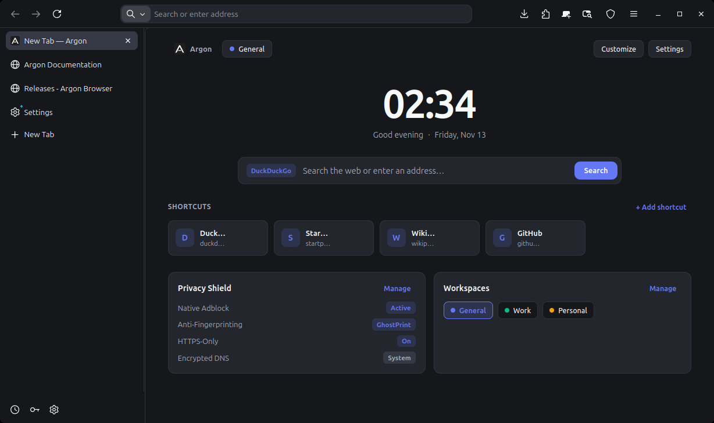
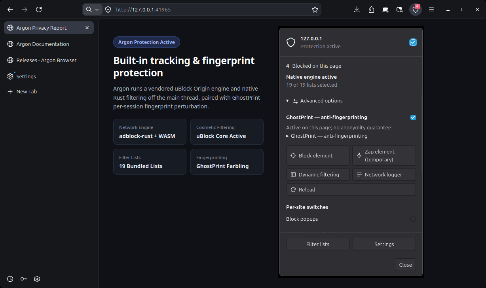
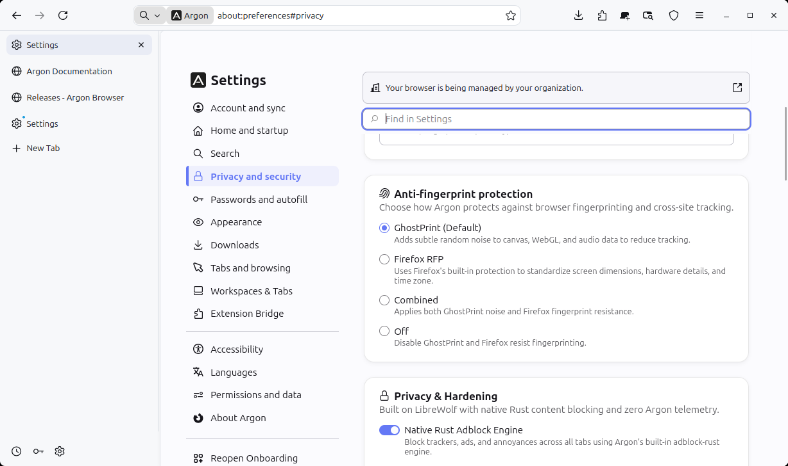
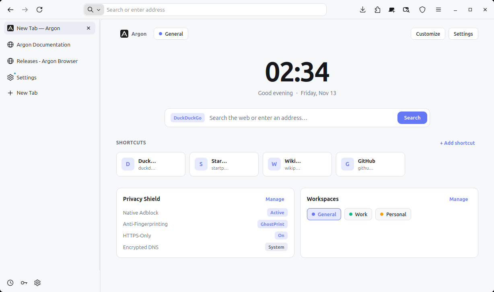
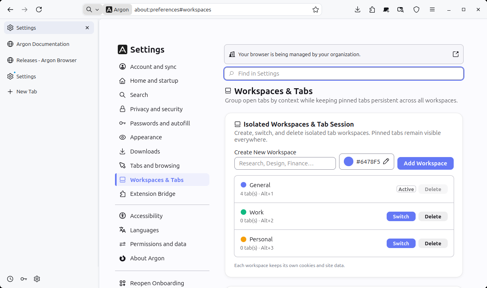
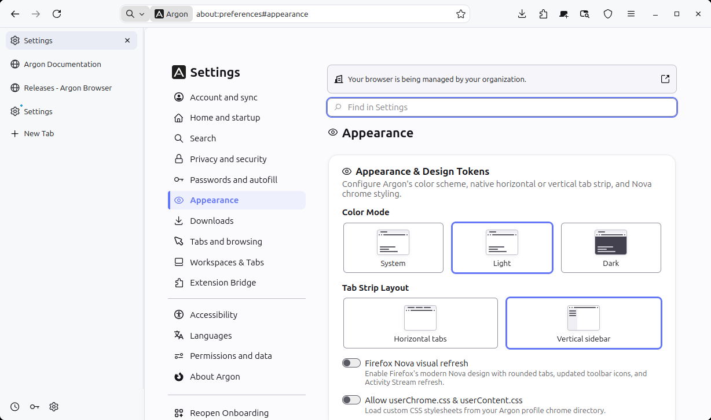
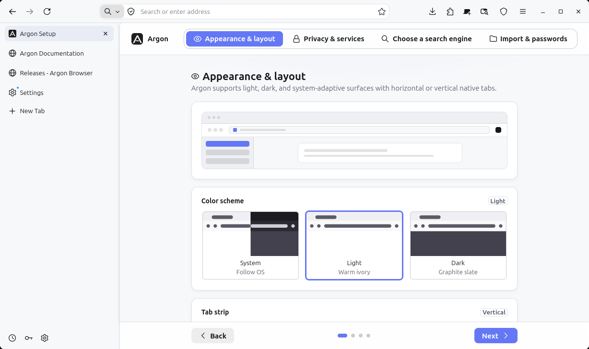

# Argon Browser

Argon is an open-source desktop web browser for Linux built on LibreWolf and Mozilla's Gecko engine. It includes vertical tabs, container-isolated workspaces, built-in content and fingerprint blocking, and a compatibility bridge for Chromium extensions.

It runs as a separate application with its own binary (`argon`), profile directory, and Flatpak package (`io.github.argon_browser.Argon`). Existing Firefox or LibreWolf profiles stay untouched, with no shared cookies, history, or active sessions.



## Install and update (Linux Flatpak)

Add the Argon Flatpak repository and install Argon:

```bash
flatpak remote-add --if-not-exists --user argon https://argon-browser.github.io/Argon/argon.flatpakrepo
flatpak install --user -y argon io.github.argon_browser.Argon
```

To update Argon when a new release ships:

```bash
flatpak update --user io.github.argon_browser.Argon
```

To launch it from a terminal:

```bash
flatpak run io.github.argon_browser.Argon
```

## Core features

### Native adblock engine

Argon has a built-in content blocker based on a vendored uBlock Origin filtering core (`ublock-engine.sys.mjs`, compiling lists off the main thread in `compile-worker.mjs`), plus optional native C-ABI/WASM tooling (`native/adblock/`).



- Network-level request evaluation preloaded with 19 bundled filter lists (`argon/adblock/lists/`), plus verified differential and scheduled list updates.
- Remote filter list subscriptions managed directly by URL.
- Interactive element picker built on Gecko's `JSWindowActor` to create persistent cosmetic rules without third-party extensions.
- Hostname and request-type dynamic filtering rules (allow, block, noop) and strict blocking.
- Procedural cosmetic filtering and scriptlet injection to defuse anti-adblock scripts and sanitize DOM elements before page scripts execute.

### GhostPrint anti-fingerprinting

GhostPrint is Argon's default anti-fingerprinting engine. It applies deterministic, seed-based perturbation ("farbling") to browser APIs.



- Perturbation across Canvas (`getImageData`, `toDataURL`, `toBlob`), WebGL (`readPixels` and normalized GPU parameters), AudioContext (`AudioBuffer`, `AnalyserNode`), WebGPU device properties, hardware concurrency, and font and MIME enumeration.
- Per-session nonce rotation that regenerates seeds between browser sessions and isolates nonces in private browsing contexts.
- In-settings engine switching in `about:preferences`: choose GhostPrint (web-compatible farbling), Firefox Resist Fingerprinting (RFP strict spoofing), or both together.

### Tab layouts and workspaces

Tab layouts work without restarting the browser or installing external add-ons:



- Dynamic switching between horizontal tabs and a collapsible vertical sidebar.
- Workspaces for organizing tabs into separate contexts (such as General, Work, and Personal) with independent active tabs.
- Every workspace runs in its own container, so cookies, localStorage, and other site data stay separated; a new tab receives its container before the first request, and moving a tab to another workspace reloads it inside the destination session.
- Pinned tabs belong to the workspace that pinned them and come back with it.
- Command palette (`Ctrl+Shift+P`) for tab search, workspace navigation, and browser commands.
- See [docs/workspaces.md](docs/workspaces.md) for the isolation model, the preferences it uses, and its limits.





### Chromium extension bridge

Argon includes a compatibility bridge to run Manifest V3 Chromium extensions alongside standard Firefox add-ons:

- Automatic translation of Chrome manifests into Gecko-compatible schemas.
- Dynamic background service worker runtime shim (`argon-mv3-runtime-shim.js`) mapping `skipWaiting` and `clients.claim` to Gecko background page lifecycles.
- API namespace aliasing from `chrome.*` to standard WebExtension APIs.
- Static analyzer for reviewing extension packages and manifest permissions prior to installation.

### First-run onboarding

Argon includes a first-run setup wizard, inspired by Helium, to pick initial defaults:



- Theme selection across System Auto, Dark, and Light, with an optional toggle for Firefox Nova styling.
- Search engine selection with privacy options (DuckDuckGo, Startpage, Brave Search, Kagi, Mojeek) alongside mainstream providers.
- Address bar state handling that conceals internal setup URLs during the initial configuration flow.
- Browser data import for bookmarks, history, and passwords from existing installations.

### Localization (i18n)

Argon includes interface translations for 45 languages in `l10n/`, with runtime language switching via the `argon.locale` preference.

## Developer workflow

The repository includes scripts for local development, synchronization, testing, and debugging.

### Development commands

| Command | Action |
| --- | --- |
| `npm run dev` | Launch the development browser with automatic file synchronization and live reload on save |
| `npm run dev:reset` | Reset the development profile to clean defaults and launch the browser |
| `npm run reset` | Reset the development profile and synchronize files without launching the browser |
| `npm run run:reset` | Alias to reset profile and start the browser |
| `npm run dev:sync` | Synchronize modified chrome and frontend files into the development profile without launching |

### Testing commands

| Command | Action |
| --- | --- |
| `npm test` | Run the full test suite (adblock, GhostPrint, cosmetics, appearance, onboarding, extensions) |
| `npm run test:dev` | Test the development server watcher and synchronization mechanisms |
| `npm run test:adblock` | Test adblock-rust filtering, cosmetic injection, and native ABI wrappers |
| `npm run test:ghostprint` | Run GhostPrint verification tests and surface perturbation checks |
| `npm run test:python` | Run Python tests for build automation, Flatpak packaging, and overlay validation |
| `npm run verify:flatpak` | Validate Flatpak metadata and verify an installed `.flatpak` bundle in an isolated user store |
| `npm run test:browser` | Execute end-to-end browser smoke tests in an isolated runtime |

## Extension compatibility analyzer

Use the command-line analyzer to inspect a Chrome extension's `manifest.json` before installing it:

```bash
npm run analyze -- path/to/manifest.json
```

The analyzer runs static checks on permissions, host declarations, and background service worker requirements, reporting any unsupported APIs or permission warnings.

## Installation

Argon is packaged primarily as a Linux Flatpak (`io.github.argon_browser.Argon`). For automatic updates through `flatpak update`, use the [Flatpak repository commands](#install-and-update-linux-flatpak) at the top of this file.

### Standalone release bundle

To install a `.flatpak` bundle downloaded manually from [GitHub Releases](https://github.com/Argon-Browser/Argon/releases):

```bash
sha256sum -c SHA256SUMS
flatpak install --user -y argon-0.1.0.en-US.linux-x86_64.flatpak
flatpak run io.github.argon_browser.Argon
```

To build and verify a `.flatpak` bundle locally from a synchronized runtime (without running a full Gecko compile):

```bash
npm run dev:sync
python3 scripts/argon.py flatpak --runtime .cache/argon-dev/runtime --output .cache/dist/argon-0.1.0.en-US.linux-x86_64.flatpak
python3 scripts/argon.py verify-flatpak --require-full-omni --bundle .cache/dist/argon-0.1.0.en-US.linux-x86_64.flatpak
```

## Building from source

Argon builds on Linux x86_64 using Mozilla's `mach` toolchain, applying LibreWolf privacy patches and the Argon overlay onto a pinned source tree.

### System requirements

- Linux x86_64
- Python 3.10 or newer
- Node.js 22 or newer
- Git
- Rust and Cargo (with `wasm32-unknown-unknown` target for rebuilding adblock artifacts)
- Minimum 8 GB RAM and 40 GB free disk space

### Build steps

```bash
npm run doctor      # Check toolchain, memory, disk space, and application identity
npm run fetch       # Download and verify the pinned upstream source archive
npm run apply       # Apply LibreWolf patches and the Argon overlay
npm run bootstrap   # Install required toolchains via mach
npm run build       # Compile dist/bin/argon
npm start           # Launch the built browser with a development profile
npm run flatpak     # Package the distributable Flatpak bundle
```

To rebuild the native filter engine and vendored cosmetic interpreter:

```bash
npm run build:adblock
python3 scripts/build-ublock-cosmetics.py
npm run update:adblock
```

## Repository layout

- `argon/`: Core Argon frontend modules (native adblock panel, workspaces, command palette, extension bridge, preferences, onboarding).
- `native/adblock/`: Rust wrapper source and build definitions for the native filter engine.
- `third_party/ghostprint/`: Pinned GhostPrint upstream source, license, and test fixtures.
- `browser/`: Firefox and LibreWolf chrome modifications, theme styling, and branding assets.
- `config/`: Upstream source configuration, mozconfig definitions, and overlay maps.
- `docs/`: Technical documentation and asset files.
- `l10n/`: Locale definitions and translation files for 45 languages.
- `packaging/`: Flatpak manifests, desktop entry files, and appstream metadata.
- `patches/`: Privacy and Linux integration patches from LibreWolf.
- `scripts/`: Development utilities, build automation, and test runners.
- `tests/`: Automated unit, integration, and browser smoke tests.
- `website/`: Landing page source and interactive extension analyzer.

## License and upstream credits

Argon Browser is open source under the [Mozilla Public License 2.0 (MPL 2.0)](./LICENSE). Individual vendored components retain their respective licenses:

- [Brave adblock-rust](https://github.com/brave/adblock-rust) (MPL 2.0): Native network filter matching engine. Rust dependency notices are in [THIRD-PARTY-NOTICES.txt](./argon/adblock/THIRD-PARTY-NOTICES.txt).
- [uBlock Origin](https://github.com/gorhill/ublock) (GPL-3.0-or-later): Cosmetic filtering logic and procedural scriptlet interpreter. Notices and license are in [argon/adblock/ublock/LICENSE.txt](./argon/adblock/ublock/LICENSE.txt).
- [GhostPrint](https://github.com/gnustella-lab/GhostPrint) (MIT): Fingerprint perturbation engine. Notices and license are in [third_party/ghostprint/LICENSE](./third_party/ghostprint/LICENSE).
- [Helium](https://github.com/imputnet/helium): Inspiration for onboarding flow and default privacy selections.
- [LibreWolf](https://librewolf.net/): Upstream privacy and security patch foundations.

Firefox is a trademark of the Mozilla Foundation.
